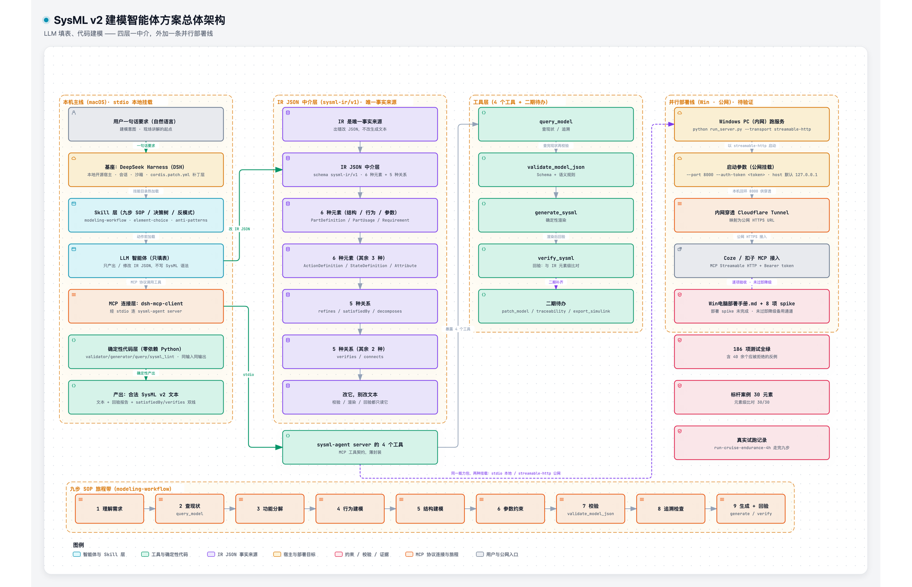

# sysml-modeling-agent

**给无人机比赛团队做的 SysML v2 建模智能体**：不让大模型直接写建模代码，而是让它只填一张
结构化的表（**IR JSON**），由确定性代码完成「校验 → 渲染 SysML v2 文本 → 回验」的闭环。

> 一句话：**LLM 填表，代码建模。** AI 负责理解人话，正确性由可审查、可复现的代码保证。

上位文档：《SysML 建模智能体技术方案》（`docs/SysML建模智能体技术方案.md`）。
本仓库是其中 **9.1 第一期 MVP（T0–T6）+ 二期（T7–T12）** 的交付物。



---

## 现状（先看这个，免得误判能力边界）

| 项 | 状态 |
| --- | --- |
| IR Schema v1（**8 种 kind** + 5 种关系） | ✅ 完成。`Constraint`（参数约束/公式）与 `Connection`（结构连接）是 **v1 增补**（2026-10-17，schema 版本号不变） |
| **九个工具**（validate / generate / query / verify / patch / trace / parse / export / **timeline**） | ✅ 完成，纯函数式；契约见 §4。`export_timeline` 为 v0.1.4 新增：读建模过程记录 → 按步骤着色的全过程 SVG |
| MCP 服务（stdio / streamable-http + Bearer 鉴权） | ✅ 完成，契约见 §3 |
| **五份 skill**（workflow / element-choice / anti-patterns / worked-examples / domain-patterns） | ✅ 完成：anti-patterns **16 条**、element-choice **9 个边界案例**、worked-examples **5 个范例**、domain-patterns **5 个模式** |
| 标杆案例（**需求 + 结构 + 参数 + 行为**） | ✅ 完成：**34 元素 / 20 关系**，行为（`StateDefinition` 飞行模式状态机）已于二期补齐 |
| 测试 | ✅ **606 个用例全绿**（含 40 余个应被拒绝的反例、25 个 timeline 用例） |
| 官方 SysML v2 解析器 | ✅ **语法与引用解析经官方 Pilot Implementation（release 2026-08）实测 0 error**（证据：`docs/probe-official-parser/EVIDENCE.txt` §13/§14）；**语义/建模质量未验证**。日常回验仍由内置 lint + 元素级比对承担 |
| MCP 协议链路（Streamable HTTP + Bearer 鉴权） | ✅ **已实测通过**：真实 MCP 客户端完成 `initialize` → `tools/list` → `tools/call`，鉴权 401 行为正确。原始输出见 [EVIDENCE.txt](docs/probe-mcp-http/EVIDENCE.txt)（那次实测记录的是当时注册的 4 个工具，现已扩到 9 个） |
| DSH 把本服务挂进 profile 并调用一次 | ✅ **已实测**（2026-10-17）：经 `cordis.patch.yml` 补丁层挂载成功，`mcp__sysml-agent__query_model` 真实调用返回正确结果。**手工写 `cordis.yml` 会被应用回写冲掉，必须走 `cordis.patch.yml`** |
| DSH 右栏「模型视图」插件（[`integrations/dsh-sysml-viz/`](integrations/dsh-sysml-viz/README.md)，v0.1.4） | ✅ 本机实测：右栏 tab（模型树 + 结构/IBD/需求/状态/参数图 + 建模中状态 + 建模过程面板 + 全过程图）。只读展示层，代码在本仓库 `integrations/`，自带 `smoke-test.mjs`（33 项）；**不参与 Python 测试套件** |
| 往返一致性（IR → 文本 → IR） | ✅ 元素级等价 + 生成字节级稳定（`parse_sysml` + `tests/test_roundtrip_v2.py`） |
| 二期 T7–T11 | ✅ 代码与测试全部落地（**T7 的「导入老师样本模型」验收待补**，见 §10）；T12 安装规范化见 §10 与 [`docs/T12-安装验收.md`](docs/T12-安装验收.md) |
| 需求变更 → 追溯影响面演示（方案 9.2 判据） | ✅ 真实执行记录：[`docs/demo/run-phase2-change/`](docs/demo/run-phase2-change/RUN.md) |
| LLM 接入本身 | ⛔ 不在本期范围（IR 由手工/工具构造代表 LLM 输出；DSH 已能挂载工具，但「LLM 自动填表」尚未做端到端验收） |

**两条红线，请一起守住**：

1. **不得宣称「生成的文本已通过官方解析器验证」**——本期没做到。
2. **标杆案例里的数值（1200 Wh / 240 W / 0.95 / 0.85 / 0.72）是占位示例值**，
   在团队用真实测试数据替换之前，**不得当作实测结论呈现**（方案 10.2）。

> 红线 1 针对的是**整体性背书**。带证据与范围限定的实测事实陈述不在此列，但必须附证据文件
> 与范围限定——现状表里那条「语法与引用解析…0 error（证据：EVIDENCE §13/§14）；语义/建模质量
> 未验证」就是这种写法，它**不**等于「已通过官方解析器验证」。

---

## 1. 目录结构

```
sysml-modeling-agent/
├── skills/                                   # T3 —— 五份 skill（MD + YAML frontmatter）
│   ├── modeling-workflow/SKILL.md            #   九步 SOP（每步含输入/产出/自检）
│   ├── element-choice/SKILL.md               #   元素选型决策树 + 9 个边界案例
│   ├── anti-patterns/SKILL.md                #   16 条反模式（现象/为什么错/正确做法/错误码）
│   ├── worked-examples/SKILL.md              #   T11 —— 5 个完整范例（从一句话到 IR+文本）
│   └── domain-patterns/SKILL.md              #   T11 —— 5 个领域模式（功率链/状态机/需求分解…）
├── mcp-server/                               # T1 + T2 + 二期 —— 工具服务
│   ├── run_server.py                         #   启动入口（接口契约见 §3）
│   ├── requirements.txt                      #   可选依赖（一个不装也能跑）
│   ├── schema/
│   │   ├── sysml-ir-v1.json                  #   IR JSON Schema（draft 2020-12）
│   │   ├── 字段说明.md                        #   字段语义 + 错误码全表
│   │   └── 渲染约定.md                        #   IR ↔ 文本的渲染/逆解析契约
│   └── tools/
│       ├── validator.py                      #   validate_model_json
│       ├── generator.py                      #   generate_sysml
│       ├── query.py                          #   query_model
│       ├── sysml_lint.py                     #   回验底座（lint + 声明抽取 + 元素级比对）
│       ├── patch.py                          #   patch_model（原子增量编辑）
│       ├── trace.py                          #   traceability（矩阵 / 缺口 / 影响面）
│       ├── parser.py                         #   parse_sysml（文本 → IR，子集逆解析）
│       ├── export.py                         #   export_simulink（CSV / JSON / MD 参数表）
│       ├── graph.py                          #   图投影（sysml-graph/v1，4 视图；不画图/不做布局）
│       ├── timeline.py                       #   建模过程 → 「建模全过程」SVG（sysml-timeline/v1）
│       └── official_parser.py                #   官方 Pilot Implementation 适配层（可选后端）
├── knowledge/                                # 知识库（本期占位 + 规划说明）
│   └── README.md
├── examples/
│   └── golden-coaxial-power-chain/           # T4 + 二期 —— 标杆案例
│       ├── golden-coaxial-power-chain.ir.json #   34 元素 / 20 关系（需求+结构+参数+行为）
│       ├── golden-coaxial-power-chain.sysml   #   生成产物，不得手改
│       └── README.md                          #   一页说明
├── tests/                                    # T5 + 二期 —— 606 个用例
│   ├── _support.py
│   ├── test_validate.py  test_generate.py  test_query.py
│   ├── test_lint_roundtrip.py  test_server.py
│   ├── test_examples.py  test_skills.py
│   ├── test_patch.py  test_trace.py  test_parse_sysml.py
│   ├── test_export.py  test_roundtrip_v2.py  test_official_parser.py
│   ├── test_graph.py  test_timeline.py
│   ├── run_tests.sh                          #   一键运行（bash）
│   └── run_tests.bat                         #   Windows 一键运行
├── docs/
│   ├── SysML建模智能体技术方案.md              # 上位文档 —— 总体方案（架构图见 docs/figures/）
│   ├── Win电脑部署手册.md                      # 上位文档 —— Windows 部署 + 内网穿透 + 鉴权
│   ├── 本机挂载试用指引.md                     # 上位文档 —— 挂到本机 DSH 的试用步骤与回滚
│   ├── figures/
│   │   └── 建模智能体方案_总体架构图.png        #   本文顶部引用的架构图
│   ├── T0-调研结论.md                         # T0 —— DSH 规范 + 解析底座选型
│   ├── T6-演示记录.md                         # T6 —— 端到端演示（含真实输出）
│   ├── T12-安装验收.md                        # T12 —— install.sh 验收记录（真实命令输出）
│   ├── 模拟侧参数表样例.md                     # T10 —— export_simulink 样例交付物
│   ├── 图投影契约.md                          #   IR → sysml-graph/v1（graph.py 配套）
│   ├── 建模过程记录契约.md                     #   过程记录 sysml-viz-history/v1 → timeline.svg
│   ├── probe-pysysml2/                        #      PySysML2 实测探针与原始输出
│   ├── probe-mcp-http/                        #      MCP 协议链路探针与原始输出
│   ├── probe-official-parser/                 #      官方解析器离线包 + EVIDENCE.txt
│   └── demo/                                  #      T6 存档 + 二期需求变更演示（run-phase2-change/）
├── integrations/                             # DSH 侧集成（JS，不参与 Python 测试）
│   ├── README.md                             #   为什么在这里、两种摆放方式、诚实边界
│   └── dsh-sysml-viz/                        #   右栏「模型视图」插件 bundle v0.1.4（含 smoke-test.mjs）
├── install.sh                                # 建 venv + 装依赖 + 注册 skill + 打印 MCP 配置
└── README.md
```

---

## 2. 快速开始

```bash
# ① 安装（建 venv、装可选依赖、把五份 skill 注册到 DSH 用户级 skill 目录）
cd sysml-modeling-agent
./install.sh                    # --copy 改用复制；--no-skills 不碰 DSH；--print-config 只看配置片段

# ② 冒烟测试（不需要任何第三方依赖）
python3 mcp-server/run_server.py --list-tools
python3 mcp-server/run_server.py --call validate_model_json \
    --input examples/golden-coaxial-power-chain/golden-coaxial-power-chain.ir.json

# ③ 跑全量测试
./tests/run_tests.sh            # Windows: tests\run_tests.bat
```

### 依赖策略（重要）

**核心逻辑全部用纯标准库实现**，因此**一个第三方依赖都不装也能完整工作**：

| 依赖 | 作用 | 缺席时 |
| --- | --- | --- |
| `fastmcp`（首选）/ `mcp`（退路） | MCP 协议外壳 | `run_server.py` 自动切到**本地调用模式**（`--list-tools` / `--call`），工具功能**完全一致**，只是不能被 DSH/扣子直接挂载 |
| `jsonschema` | 第二层 JSON Schema 交叉检查 | `schemaLayer: "unavailable"`，纯标准库规则引擎**功能不减** |

所以：**装不上依赖不停工**。这也是 Windows 部署机的保险——解析器装不上的风险已被移除。

---

## 3. 启动命令（接口契约，**部署手册按此引用，勿改动**）

```bash
python run_server.py [--transport stdio|streamable-http] [--port 8000] \
                     [--auth-token <token>] [--host 127.0.0.1]
```

| 参数 | 默认 | 说明 |
| --- | --- | --- |
| `--transport` | `stdio` | `stdio` 本地接 DSH；`streamable-http` 供云端（扣子/Coze）接入 |
| `--port` | `8000` | 仅 `streamable-http` 生效 |
| `--auth-token` | 无 | **可选；仅 streamable-http 校验**。设置后要求请求头 `Authorization: Bearer <token>`，不匹配返回 `401` |
| `--host` | `127.0.0.1` | 仅 `streamable-http` 生效。**默认只监听本机回环**（内网穿透客户端与本体同机，够用）；如需局域网访问请显式传 `0.0.0.0` |

常用示例：

```bash
# 本地 stdio（DSH 直连）
python run_server.py

# 起 HTTP 服务（公网暴露前务必设置 --auth-token！）
python run_server.py --transport streamable-http --port 8000 --auth-token <随机长串>

# 本地调用模式（没有 MCP 依赖时的等价退路）
python run_server.py --list-tools
python run_server.py --call validate_model_json --input model.ir.json
python run_server.py --call generate_sysml       --input model.ir.json
python run_server.py --call query_model --input '{"model": {...}, "unsatisfied_requirements": true}'
python run_server.py --call query_model --input '{"path": "examples/golden-coaxial-power-chain/golden-coaxial-power-chain.ir.json"}'
python run_server.py --call verify_sysml --input '{"text": "...", "model": {...}, "official": true}'
python run_server.py --call patch_model  --input '{"model": {...}, "ops": [{"op": "update_element", "id": "...", "element": {...}}]}'
python run_server.py --call traceability --input '{"model": {...}, "focus": "REQ-CRUISE-ENDURANCE", "fmt": "md"}'
python run_server.py --call parse_sysml  --input '{"text": "..."}'
python run_server.py --call export_simulink --input '{"model": {...}, "fmt": "csv", "scope": "all"}'
```

> 这个契约与随包的 `@deepseek-ai/dsh-mcp-client` 文档（`README.zh.md`）字段**一一对应**
> （`transport: stdio|streamable-http` + `headers.Authorization`，且 stdio 不需要鉴权），
> 来源于文档最小配置示例；**真机挂载已于 2026-10-17 实测通过**（见上文「现状」表），
> 见 [T0 结论 §1.3](docs/T0-调研结论.md)。

**这个契约不做的事（部署前须知）**：

- **只有 `--auth-token` 一种鉴权方式**，即请求头 `Authorization: Bearer <token>`。
  **没有**「把 token 塞进 URL 路径」的形态（如 `/mcp/<token>`）。
  若云端平台无法携带自定义请求头，请**在反向代理层**（Caddy / Nginx / Cloudflare 规则）解决，
  不要为此改动本契约——部署手册 §5.3 也是这么约定的。
- **没有 HTTPS**：服务只提供明文 HTTP。公网暴露必须由穿透/反代层提供 TLS。
- **`--host` 默认只绑 `127.0.0.1`**：默认只绑 127.0.0.1，不替你开 0.0.0.0
  （如需局域网暴露请显式 `--host 0.0.0.0` 并自担风险）。

---

## 4. 九个工具

| 工具名 | 职责 | 返回 |
| --- | --- | --- |
| `validate_model_json` | Schema + 语义规则校验 IR | `{ok, errors:[{code,element,message}], warnings:[...], schemaLayer}` |
| `generate_sysml` | IR → SysML v2 文本，**确定性**（同输入必得同输出；返回 `sha256` 供验证） | `{ok, text, errors, warnings, stats, sha256}` |
| `query_model` | 关键字/kind 查元素、查某 id 的引用者、查重名、列未被满足的需求；也可用 `path` 直接读服务端本地 IR 文件（与 `model` 二选一，受 `SYSML_QUERY_ROOT` 限制） | `{ok, mode, count, results, ...}` |
| `verify_sysml` | **方案 §5.2 的 `parse_sysml` 之外的回验快捷工具**：语法自查（带行列定位）+ 声明抽取 + 与 IR 元素级比对；`official=true` 时追加官方解析器结果 | `{ok, counts, missing, extra, mismatched, lint[, official]}` |
| `patch_model` | 增量编辑（原子）：`add_element` / `update_element` / `remove_element` / `add_relation` / `remove_relation`；任何一步失败或补丁后校验不过就**整体回滚**，`diff` 标注已回滚步骤 | `{ok, model, diff:[{change,kind,id,detail}], errors, warnings}` |
| `traceability` | 需求追溯矩阵（4 种状态）+ 覆盖缺口 + `focus` 反向引用影响面（直接/传递/受影响需求）；`fmt="md"` 额外返回 Markdown 矩阵 | `{ok, matrix, gaps, impact, content, errors}` |
| `parse_sysml` | 文本 → IR（**只解析本工具链的渲染子集**）；子集外构造逐条进 `unsupported`（带行号）并令 `ok=false`；名字→id 不唯一时报 `E-PARSE-AMBIGUOUS` / `E-PARSE-UNRESOLVED`，不猜 | `{ok, model, warnings, unsupported, errors, stats}` |
| `export_simulink` | 把 `Attribute` / `Constraint` / 需求阈值导出成仿真侧参数表（`csv` BOM+CRLF / `json` / `md`），参数值直接取自 IR | `{ok, content, rows, notes, errors}` |
| `export_timeline` | 读建模过程记录（`<workspace>/.sysml-viz/history/` 的 index + 每步快照）→ **「建模全过程」SVG**：生长树按元素首次出现步骤着色、图例含每步时间/会话/轮次/增量、底部元素数曲线。`history_dir` 不传时自动向上查找；不修改 IR | `{ok, schema:"sysml-timeline/v1", svgPath, summary, steps, errors, warnings}` |

工具对 DSH 呈现为 `mcp__sysml-agent__<工具名>`。

**生成器会先校验再渲染**：IR 有 error 时拒绝产出文本并把错误原样返回——
目的是逼 LLM **改 JSON 而不是改文本**（方案 2.3 第 4 步）。

**推荐调用顺序**（与 `run_server.py` 的 `INSTRUCTIONS` 一致）：
`query_model` 查现状 → 填/改 IR JSON → `validate_model_json` 改到 errors 为空 →
（可选 `patch_model`，改完回到 validate）→ `generate_sysml` → `verify_sysml`（可带 `official`）→
可选 `parse_sysml` 往返 → `traceability` 查覆盖与影响面 → `export_simulink` 出参数表 →
（可选）`export_timeline` 出建模全过程图。

---

## 5. 跑测试

```bash
./tests/run_tests.sh          # 606 个用例，详细输出；追加 -q 安静模式
PYTHON=python3.12 ./tests/run_tests.sh
cd tests && python3 -m unittest discover -s . -t .    # 手工跑也可以
```

只用标准库 `unittest`，**不依赖 pytest**。当前 **606 个用例**，覆盖：

- 各类**应被拒绝**的反例（缺 `acceptanceCriteria`、`relations.target` 悬空、同 owner 重名、
  `kind` 枚举自创、数值字段写成字符串、`typeRef` 悬空……）
- **确定性**：生成的文本与 sha256 两次一致；JSON 键序变化不影响输出
- **回验**：能抓住文本里少了的 / 多出来的 / 对不上的声明，**并诚实固化它抓不到什么**
- **往返一致性**（T7）：`IR → 文本 → IR` 元素级等价 + 两次生成逐字节一致；手写同子集文本也能稳定往返
- **增量编辑**（T8）：`patch_model` 五类 op 的正反例、原子回滚、`cascade` 语义（`typeRef` 引用方整元素删除、`owner` 子树删除）
- **追溯**（T9）：矩阵四种状态、三处缺口、`focus` 直接/传递影响面；`query_model` 引用边口径与 `SYSML_QUERY_ROOT` 路径加固
- **逆解析**（T8/T11）：`parse_sysml` 的子集边界、`unsupported` 逐条带行号、名字→id 歧义不猜测
- **导出**（T10）：`export_simulink` 三种格式、每行 kind、占位值提示进 `notes`
- **官方解析器**（T7）：后端不可用时 `status="unavailable"` 且**绝不**报 ok；有诊断时 `verify_sysml(official=true)` 失败关闭
- **启动契约**：`--transport/--port/--host/--auth-token`（含 `--host` 默认 127.0.0.1）、
  Bearer 鉴权（缺头/错头/前缀不匹配都拒绝）
- **产物一致性**：仓库里存档的 `.sysml` 必须与生成器逐字节一致（防手工漂移）
- **skill 结构**：五份 skill 齐备——九步 SOP 每步有输入/产出/自检、决策树与边界案例数、反模式条数与必需条目、范例与领域模式的结构约束
- **跨平台**：源码里不得出现硬编码的 macOS 路径

---

## 6. 标杆案例

[`examples/golden-coaxial-power-chain/`](examples/golden-coaxial-power-chain/README.md)：
一条从**任务级续航（≥5 h）→ 巡航续航（≥4 h）→ 转速比区间 [0.75, 1.25]** 的需求链，
加上**电池 → 电调 → 电机 → 桨（上下桨各一条支路）**的功率链，
把 `1200 Wh × 0.8 ÷ 240 W = 4.0 h` 串起来的参数换算（正式 `Constraint`），
以及一条**飞行模式状态机**（`Takeoff → Cruise → ReturnToHome → Landed`，含 `Fault` 分支）。

`validate_model_json` → `ok=true`，**0 error 0 warning**；`verify_sysml` → **34/34 元素匹配**。

**需求 + 结构 + 参数 + 行为四类元素齐备**（共 34 个元素 / 20 条关系）：
参数公式由正式 `Constraint`（`EnduranceBudget`）承载，行为由 `StateDefinition`
（`FlightModeStates`，5 状态 / 5 迁移）承载，结构连接由 `Connection` 承载。
这几条都由测试钉住（`tests/test_examples.py`），改坏了会红。

---

## 7. skill 怎么注册到 DSH

T0 实机调研结论（**不是猜的**，来自 DSH 随包文档，见 [T0 §1.2](docs/T0-调研结论.md)）：

- **用户级 skill 根目录 = `$DSH_HOME/skills`**（`$DSH_HOME` 默认 `~/.dsh`）
- 格式：`<name>/SKILL.md`（目录 bundle）或 `<name>.md`（平铺文件）；
  **不支持**递归发现 `**/SKILL.md`
- YAML frontmatter **必填 `name` 与 `description`**，可选 `whenToUse` / `metadata` /
  `disable-model-invocation` / `user-invocable`
- 目录被**监视**：新增/改名/删除 skill 会在下一个模型步骤生效，**无需重启**

`./install.sh` 默认会为五份 skill 建**符号链接**（与 DSH 既有 skill 的做法一致）；
没有符号链接权限时自动改为复制，也可显式 `--copy`。

**这五份 skill 分别管什么**（按加载时机排）：

| skill | 什么时候用 | 内容 |
| --- | --- | --- |
| `modeling-workflow` | 任何要产出/修改模型的请求 | 九步 SOP，每步含输入/产出/自检 |
| `element-choice` | 犹豫「这条该建成什么」 | 四个岔路口决策树 + 9 个边界案例 |
| `anti-patterns` | 报错、被打回、动手前扫坑 | 16 条反模式（现象/为什么错/正确做法/错误码） |
| `worked-examples` | 想「照着抄一份」 | 5 个从一句话到 IR + 文本的完整范例 |
| `domain-patterns` | 建新领域模型 | 5 个领域模式（功率链、状态机、需求分解…） |

> **未确认项**：DSH 没有提供官方的「skill 一键安装」命令（`dsh --help` 与
> `dsh plugin --help` 里都没有），因此走「手工放文件」这条路。

---

## 8. 与部署手册的关系

本仓库是**被部署方**，部署步骤在 **`docs/Win电脑部署手册.md`**（由并行任务产出）。
两者的接口只有一个：本 README §3 的**启动命令契约**，手册按该契约引用：

```bash
python run_server.py --transport streamable-http --port 8000 --auth-token <token>
```

分轨说明（方案 8.2）：

| 轨道 | 怎么用本仓库 |
| --- | --- |
| **开发 / 干活轨**（DSH + 本地工具链） | `./install.sh` 注册 skill，并按 `install.sh` 打印的片段把 MCP 服务挂进 `cordis.yml`（stdio 模式） |
| **展示 / 共享轨**（扣子 / Coze） | 在 Win 电脑上以 `streamable-http` 起服务 + 内网穿透得到公网 URL，扣子侧粘贴 MCP JSON（详见部署手册） |

> 云端接入的两个已知工程风险（方案 8.5）：**MCP 服务必须公网可达**；
> **单次调用有超时上限**。因此重活儿要留在本地轨，展示前至少一周先打通链路并压测。

---

## 9. 进一步阅读

| 想了解 | 看 |
| --- | --- |
| DSH 到底查到什么、没查到什么；解析底座为什么选它 | [`docs/T0-调研结论.md`](docs/T0-调研结论.md) |
| 总体方案（上位文档） | [`docs/SysML建模智能体技术方案.md`](docs/SysML建模智能体技术方案.md) |
| Windows 部署 + 内网穿透 + 鉴权 | [`docs/Win电脑部署手册.md`](docs/Win电脑部署手册.md) |
| 挂到本机 DSH 怎么试用、怎么回滚 | [`docs/本机挂载试用指引.md`](docs/本机挂载试用指引.md) |
| 完整走一遍「加一条需求」的流程（含真实输出） | [`docs/T6-演示记录.md`](docs/T6-演示记录.md) |
| 需求变更 → 追溯矩阵自动反映影响范围（二期演示，真实输出） | [`docs/demo/run-phase2-change/RUN.md`](docs/demo/run-phase2-change/RUN.md) |
| 每种 IR 字段的语义、全部错误码 | [`mcp-server/schema/字段说明.md`](mcp-server/schema/字段说明.md) |
| IR ↔ 文本怎么渲染、怎么逆解析 | [`mcp-server/schema/渲染约定.md`](mcp-server/schema/渲染约定.md) |
| 建模该按什么顺序做 | [`skills/modeling-workflow/SKILL.md`](skills/modeling-workflow/SKILL.md) |
| 该用哪种元素 | [`skills/element-choice/SKILL.md`](skills/element-choice/SKILL.md) |
| 已知的坑 | [`skills/anti-patterns/SKILL.md`](skills/anti-patterns/SKILL.md) |
| 照着抄的 5 个完整范例 | [`skills/worked-examples/SKILL.md`](skills/worked-examples/SKILL.md) |
| 常见领域套路（功率链 / 状态机 / 需求分解…） | [`skills/domain-patterns/SKILL.md`](skills/domain-patterns/SKILL.md) |
| 标杆案例讲的是什么 | [`examples/golden-coaxial-power-chain/README.md`](examples/golden-coaxial-power-chain/README.md) |
| 导出的仿真参数表长什么样 | [`docs/模拟侧参数表样例.md`](docs/模拟侧参数表样例.md) |
| 安装脚本验收记录（真实命令输出） | [`docs/T12-安装验收.md`](docs/T12-安装验收.md) |
| 知识库怎么规划 | [`knowledge/README.md`](knowledge/README.md) |
| DSH 右栏模型视图插件怎么装、怎么自检、边界在哪 | [`integrations/README.md`](integrations/README.md) |

---

## 10. 版本与二期进度（2026-10-17）

- **IR Schema 版本**：`sysml-ir/v1`。Schema 升级时必须同步升级生成器与测试集。
- **一期（T0–T6）**：一句话需求 → IR JSON → 合法 SysML v2 文本，最小闭环跑通。
- **二期（T7–T12）**：往返一致性、增量编辑、追溯、官方解析器、参数导出、范例与领域模式、
  安装规范化——**全部落地**，测试从 186 增到 **527**。

| 任务 | 内容 | 状态 | 证据 / 说明 |
| --- | --- | --- | --- |
| **T7** | 官方解析器接入 + 往返一致性 | ✅ 代码落地 | `tools/official_parser.py`、`tests/test_official_parser.py`、`tests/test_roundtrip_v2.py`；实测证据 `docs/probe-official-parser/EVIDENCE.txt` §13/§14（**只覆盖语法与引用解析**，语义未验证） |
| T7 验收·导入老师样本模型 | 用老师给的 SysML v2 样本做导入验收 | ⏳ **待补导入验收** | 老师样本未到。现有往返一致性以 **golden + demo 存档 IR + 手写同子集变体**覆盖（`tests/test_roundtrip_v2.py` 的 `DEMO_IR_FILES` 与 `HAND_WRITTEN`），样本到手后按其样式再对齐一次 |
| **T8** | `parse_sysml` 逆解析 + `patch_model` 增量编辑 | ✅ 完成 | `tools/parser.py`（子集边界、`unsupported` 带行号）、`tools/patch.py`（原子/结构化 diff/cascade）；`tests/test_parse_sysml.py`、`tests/test_patch.py` |
| **T9** | `traceability` + `query_model` 引用边/路径加固 | ✅ 完成 | `tools/trace.py`（matrix/gaps/impact）、`tools/query.py`（`path` + `SYSML_QUERY_ROOT`）；`tests/test_trace.py`、`tests/test_query.py` |
| **T10** | `export_simulink` 参数导出 | ✅ 完成 | `tools/export.py`（CSV/JSON/MD）；`tests/test_export.py`；样例交付物 `docs/模拟侧参数表样例.md` |
| **T11** | `worked-examples`（5 范例）+ `domain-patterns`（5 模式）两份 skill | ✅ 完成 | `skills/worked-examples/`、`skills/domain-patterns/`；`tests/test_skills.py` 钉住结构 |
| **T12** | 安装规范化（`install.sh` 验收） | ✅ 完成 | [`docs/T12-安装验收.md`](docs/T12-安装验收.md)：真实 `./install.sh --print-config` 输出（含 `.venv/bin/python`、`cwd`、5 个 skill） |

**仍未做（如实列出）**：

1. **LLM 真实接入的端到端验收**——DSH 挂载已于 2026-10-17 实测（见「现状」表），
   但「模型自己按 SOP 填表」没有做成可复现的验收用例，IR 目前仍由手工/脚本构造。
2. **老师样本模型的导入验收**（T7 的那一条）——样本未到，见上表。
3. **官方解析器的语义层结论**——现有证据只到「语法与引用解析 0 error」，
   语义/建模质量未验证；不要把这条读成「已通过官方解析器验证」。
4. **标杆案例数值的真实性**——1200 Wh / 240 W / 0.95 / 0.85 / 0.72 / 4.0 h / 0.75 全是占位值，
   等真实选型/台架/试飞数据替换（红线 2）。
