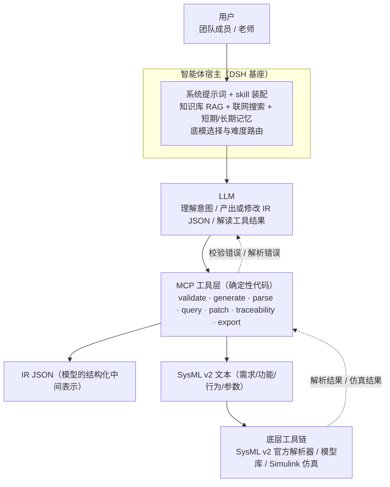
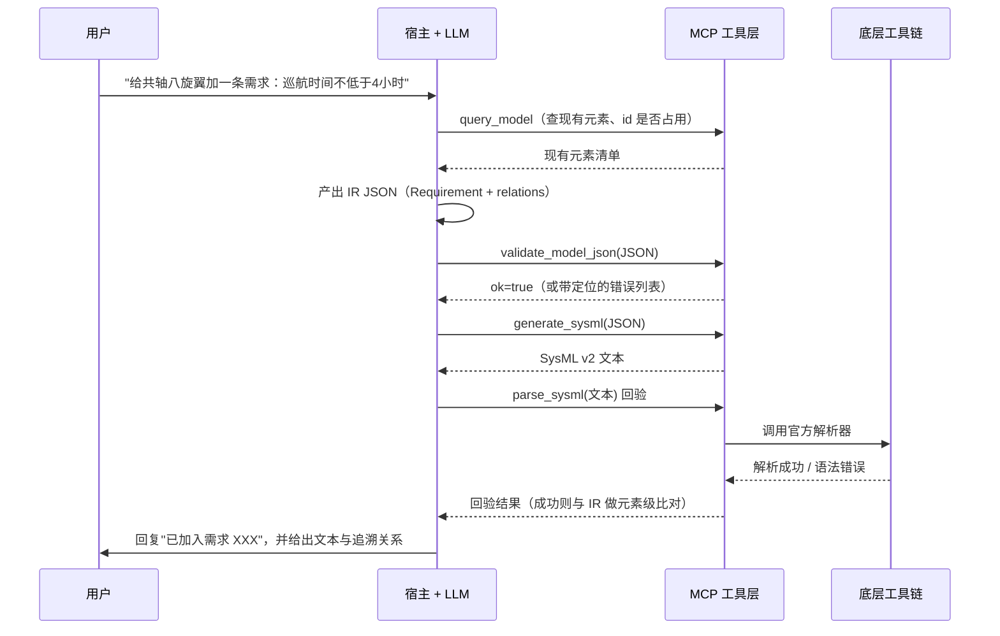

# SysML 建模智能体技术方案

> **项目**：2610_MBSE —— 共轴八旋翼 / 四旋翼无人机在线能耗优化，基于 MBSE 方法论
> **读者**：团队成员、指导老师
> **一句话摘要**：为比赛团队构建一个共享的 SysML v2 建模智能体；不让大模型直接写 SysML 代码，而是让大模型只填结构化 JSON，由确定性代码完成"JSON → SysML v2 文本 → 解析回验"的闭环，再用 skill、知识库、MCP 工具与记忆把可靠性补起来。

---

<a id="toc"></a>

## 目录

- [1. 背景与目标](#ch1)：[项目背景](#ch1-1) · [会议要求](#ch1-2) · [路线共识](#ch1-3) · [目标](#ch1-4)
- [2. 核心设计思想：LLM 填表、代码建模](#ch2)：[IR 是什么](#ch2-1) · [为何不让 LLM 直接写](#ch2-2) · [贯穿例子](#ch2-3) · [四个好处](#ch2-4)
- [3. 总体架构](#ch3)：[分层图](#ch3-1) · [各层职责](#ch3-2) · [能力分工](#ch3-3) · [飞轮机制](#ch3-4)
- [4. IR JSON Schema 设计](#ch4)：[元模型子集](#ch4-1) · [统一骨架](#ch4-2) · [MVP 元素](#ch4-3) · [设计原则](#ch4-4)
- [5. MCP 工具层](#ch5)：[MCP 是什么](#ch5-1) · [工具清单](#ch5-2) · [调用时序](#ch5-3) · [技术选型](#ch5-4)
- [6. skill 体系](#ch6)：[原理](#ch6-1) · [五个 skill](#ch6-2) · [与工具知识库分工](#ch6-3) · [按需加载](#ch6-4)
- [7. 数据与案例策略](#ch7)：[不需要大规模训练数据](#ch7-1) · [数据清单](#ch7-2) · [标杆案例](#ch7-3) · [来源排序](#ch7-4)
- [8. 基座选型与部署分发](#ch8)：[宿主解耦](#ch8-1) · [双轨策略](#ch8-2) · [双轨对比](#ch8-3) · [打包形态](#ch8-4) · [风险提示](#ch8-5)
- [9. 落地分期](#ch9)：[第一期 MVP](#ch9-1) · [第二期](#ch9-2) · [第三期](#ch9-3) · [分期总表](#ch9-4)
- [10. 能力边界与风险](#ch10)：[下限与上限](#ch10-1) · [数据真实性](#ch10-2) · [其他风险](#ch10-3)
- [11. 与展示叙事的对接](#ch11)：[三段式](#ch11-1) · [第四亮点](#ch11-2) · [评委问答](#ch11-3)
- [12. 参考资料](#ch12)

---

<a id="ch1"></a>

## 1. 背景与目标

> **本章要点**：讲清这个智能体为什么存在、会上老师提了什么要求、团队共识的技术路线是什么。

### 1.1 项目背景

<a id="ch1-1"></a>

我们是参加面向 2610 系统规划（MBSE）比赛的团队，研究题目是**共轴八旋翼（X8）无人机的在线能耗优化**。

- **共轴八旋翼（X8）**：四根机臂，每臂上下两副桨共轴叠放，共八副桨。
- **MBSE（基于模型的系统工程）**：用"模型"而非 Word 文档作为需求、功能、行为、架构、参数的主要工程载体，模型之间可追溯、可校验、可复用。
- **在线能耗优化**：飞行中"边飞边算"，实时调节平飞速度 *v* 与上下桨转速比 *eta*（上桨转速 ÷ 下桨转速），让飞行功率尽量小。项目已在 MATLAB R2022b / Simulink 上搭好"风场 → 物理对象 → 控制 → 评价"四层闭环仿真。

也就是说，我们既有**模型化的研究对象**，又有**明确的 MBSE 交付要求**。两者叠加，正是 SysML v2 最能发挥作用、也最耗人力的场景：一次需求变更要牵动需求条目、功能分解、状态机、参数公式与追溯矩阵。

因此我们决定做一个 **SysML 建模智能体**：它不替团队下研究结论，而是作为**团队的一名"建模成员"**，把用户的一句自然语言需求，变成规范、合法、可追溯的 SysML v2 模型，并把需求—功能—行为—参数—仿真串成一条链。

### 1.2 会议要求摘要

<a id="ch1-2"></a>

会议（转写稿：`3749ae0c936b2691973a0dd5e333096f_raw.mp3.txt`，内部资料、未随仓库分发）中，老师（讲话人 1）提出的要求是本方案的直接输入：

1. **引入 MCP、skill、知识库**，不能只做一个纯聊天机器人。
2. **做成共享智能体**：全组登录同一个，而不是每人各建一个通用助手。
3. **平台后台配置齐全**：系统提示词（老师已提供一批 SysML v2 样本模型）；基础模型选择，可做成**按问题难度自动路由**；**知识库 + 知识过滤**；**联网搜索**；**插件 / MCP**（甚至工作流）；**短期记忆与长期记忆**。
4. **幻觉要纠正并进入长期记忆**：人工指出错误后它要长期记住，不再犯同样的错。
5. **展示叙事**：给智能体起名，讲成"团队成员之一"；功能分三块讲——harness 驾驭工程（含底模路由）、知识库 RAG + 联网、记忆。
6. **建模部分**：讲清需求 / 功能 / 行为，最后落到**仿真集成**；用数据与公式把故事讲厚，不能只讲"风"这一件事。

### 1.3 核心技术路线共识

<a id="ch1-3"></a>

在"怎么做才可靠"上，团队共识是一条主线：

> **不让 LLM 直接写 SysML 建模代码。走"LLM → JSON 中间表示 → 确定性转换 / 校验 → SysML v2 文本"的路线。**

更直白地说：**LLM 负责"填表"，代码负责"建模"**。大模型擅长理解人话、判断意图、组织结构；不擅长逐字符遵守一门严格、冷门、语料稀少的建模语言语法。把这两件事拆开各自交给擅长的一方，正确率就从"看运气"变成"看流程"。

### 1.4 目标

<a id="ch1-4"></a>

| 编号 | 目标 | 可验收的一句话判据 |
| --- | --- | --- |
| G1 | 端到端闭环可用 | 用户说"给共轴八旋翼加一条需求：巡航时间不低于 4 小时"，输出一段语法合法的 SysML v2 文本 |
| G2 | 产出可信 | 生成的文本能通过解析器回验，JSON 通过 Schema 与语义规则校验 |
| G3 | 全组共享 | 团队成员登录同一智能体，知识与记忆共享 |
| G4 | 能力可积累 | 纠错进入记忆，反模式清单与领域模板随使用变厚 |
| G5 | 展示成立 | 撑起"团队成员之一 + 三大功能 + SysML 专业能力"的叙事 |

---

<a id="ch2"></a>

## 2. 核心设计思想：LLM 填表、代码建模

> **本章要点**：解释中间表示（IR）是什么、为什么必须用它，并用一个完整例子从自然语言走到 SysML v2 文本。

### 2.1 什么是中间表示（IR）

<a id="ch2-1"></a>

**中间表示（IR，Intermediate Representation）**：指一份**结构化 JSON 数据**，描述模型里有哪些元素、每个元素是什么种类、叫什么名字、属于谁、带哪些属性、与谁有关系。

打个比方，IR 像**装修的测量单**：业主说"我想要个放得下双人床的卧室"，设计师不会直接去锯木头，而是先出一张标注尺寸、位置、材料的测量单；施工队照单施工，尺寸错了在单子上就能发现，不用等墙砌歪了再砸。IR 就是这张测量单——LLM 填单子，确定性代码照单施工。

### 2.2 为什么不让 LLM 直接写 SysML

<a id="ch2-2"></a>

1. **SysML v2 文本语法严格且容易幻觉。** 它采用新的文本记法（`part def`、`requirement def`、`attribute :>> x = ...` 这类写法），拼写、冒号、`def` 与 usage 的区分稍有差错就整体非法。而它在训练语料中的密度远低于 Python，模型"见得少"，出错是常态。更麻烦的是它错得很自信：看起来很像对的代码，解析器一跑就报错。
2. **模型本质上是结构化数据。** 一个系统模型 = 元素集合 + 元素间关系 + 属性值。用 JSON 表达天然合适：**可校验**（一份 Schema 挡下大部分形式错误）、**可 diff**（改了什么在 git 里一眼可见）、**可增量编辑**（只改一棵子树，不必重生成整份文件）。
3. **确定性转换器可靠且便宜。** "JSON → SysML v2 文本"是纯字符串渲染：输入相同、输出必然相同，不耗 token、不产生幻觉、不随模型版本漂移。语法正确性由**生成器代码**保证，而不是由模型的"语感"保证。

一句话：**把不确定性关在最小范围里**。LLM 的不确定性被限制在"填 JSON 字段"这一层，而这一层恰恰能被 Schema 严格约束；出了这一层，全是确定性的工程代码。

### 2.3 一个贯穿全文的例子

<a id="ch2-3"></a>

用同一句话贯穿全文：**"给共轴八旋翼加一条需求：巡航时间不低于 4 小时。"**

**第 0 步：用户一句话。** 如上。

**第 1 步：LLM 产出 IR JSON。** 它不写 SysML，只填这张表（`properties.text` 存原文，`acceptanceCriteria` 存可验证判据，`relations` 存与其他元素的关系）：

```json
{
  "schema": "sysml-ir/v1",
  "package": "CoaxialOctoRotor",
  "elements": [
    {
      "id": "REQ-CRUISE-ENDURANCE",
      "kind": "Requirement",
      "name": "CruiseEndurance",
      "owner": "CoaxialOctoRotor",
      "properties": {
        "text": "巡航时间不低于 4 小时",
        "acceptanceCriteria": "在巡航速度 v 与转速比 eta 的稳态工作点下，满电续航时间 T >= 4.0 h",
        "minEnduranceHours": 4.0,
        "verifyMethod": "simulation"
      },
      "relations": [
        { "type": "refines",     "target": "REQ-MISSION-ENDURANCE", "rationale": "由任务级续航需求分解而来" },
        { "type": "satisfiedBy", "target": "PART-POWER-CHAIN",      "rationale": "由功率链（电池→电调→电机→桨）的设计参数保障" }
      ]
    }
  ]
}
```

两个细节正是"可靠"的来源：`relations[].target` 必须指向模型内**已存在**的 id（由第 2 步强制）；`minEnduranceHours` 是数值而非字符串，能直接参与计算与导出。

**第 2 步：validate 校验。** 调 `validate_model_json`，既做 Schema 校验（字段是否齐全、`kind` 是否在受控枚举内、类型是否正确），也做语义校验（id 唯一、`relations.target` 均可解析、`owner` 存在、`Requirement` 必须带验收判据）：

```json
{
  "ok": true,
  "errors": [],
  "warnings": [
    {
      "code": "W-REQ-NO-VERIFY",
      "element": "REQ-CRUISE-ENDURANCE",
      "message": "该需求标注 verifyMethod=simulation，但尚未建立指向仿真用例的 verify 关系"
    }
  ]
}
```

**第 3 步：generate_sysml 生成文本。** 模板渲染器的输出形态示意（真实文本由生成器产出，字段值来自上面的 JSON）：

```sysml
package CoaxialOctoRotor {

    requirement def CruiseEndurance {
        doc /* 巡航时间不低于 4 小时 */
        attribute minEnduranceHours : Real = 4.0;
        attribute verifyMethod : String = "simulation";
    }

    part def CoaxialOctoRotorSystem {
        requirement cruiseEndurance : CruiseEndurance;
    }

    // 追溯关系由 relations 渲染：
    //   REQ-CRUISE-ENDURANCE --refines--> REQ-MISSION-ENDURANCE
    //   REQ-CRUISE-ENDURANCE --satisfiedBy--> PART-POWER-CHAIN
}
```

**第 4 步：解析回验，形成闭环。** 产物交给 `parse_sysml`（底层用官方解析器）读回：解析成功说明语法合法，并可与原始 IR 做元素级比对，确认"想生成的确实生成了"；解析失败则把带定位的错误直接反馈给 LLM，让它**改 JSON 而不是改文本**。整条链路上，模型的每一次发言都被确定性程序检查过。

### 2.4 这条路线带来的四个好处

<a id="ch2-4"></a>

1. **语法正确率的上限被拉满**：只要 JSON 通过校验，输出文本必然语法正确。
2. **错误可定位、可解释**：错误码指向具体元素与字段，比"这段代码好像有点问题"有用得多。
3. **人工可介入**：JSON 人能读能改；老师评审看到的是一张结构表，而不是一堆建模代码。
4. **可追溯、可版本化**：JSON 可 diff、可存档，配合 git 天然得到模型演化史——这正是 MBSE 想要的东西。

---

<a id="ch3"></a>

## 3. 总体架构

> **本章要点**：给出分层架构、各层职责、四种能力的分工，以及"越干活越聪明"的飞轮机制。

### 3.1 分层架构图

<a id="ch3-1"></a>



不方便渲染 Mermaid 时，可用这个纯文本版对照：

```
        用户
         │
         ▼
 智能体宿主（DSH 基座）：提示词 · skill · 知识库 RAG · 联网 · 记忆
         │
         ▼
      LLM（理解意图 / 产出并修改 IR JSON / 解读结果）
         │
         ▼
 ┌────────────────────────────────────────────┐
 │ MCP 工具层（确定性代码，不产生幻觉）          │
 │ validate · generate · parse · query · patch │
 │ traceability · export_simulink              │
 └────────────────────────────────────────────┘
         │                        │
         ▼                        ▼
   IR JSON（结构化）        SysML v2 文本（语法合法）
         └────────────┬───────────┘
                      ▼
        底层工具链：解析器 / 模型库 / Simulink
```

### 3.2 各层职责

<a id="ch3-2"></a>

| 层 | 一句话职责 |
| --- | --- |
| 用户 | 用自然语言提出建模诉求：加需求、改参数、查追溯、导出参数 |
| 智能体宿主（DSH 基座） | 把提示词、skill、知识库、联网、记忆组织成一次完整上下文，并决定用哪个底模 |
| LLM | 理解意图，产出或修改 IR JSON，调用工具，解读工具结果并用人话回复 |
| MCP 工具层 | 所有"必须做对"的操作交给确定性代码：校验、渲染、解析、查询、增量修改、追溯、导出 |
| IR JSON | 模型的唯一事实来源（single source of truth），人和机器都能读 |
| SysML v2 文本 | 对外交付物：可评审、可被工具链消费的建模产物 |
| 底层工具链 | 官方解析器判定语法，模型库负责存储，Simulink 负责仿真验证 |

### 3.3 能力分工表

<a id="ch3-3"></a>

四种能力各补一个短板，缺一不可：

| 能力 | 类比 | 补的短板 | 具体内容 |
| --- | --- | --- | --- |
| **skill** | 老师傅的**操作手册** | 补"认识与判断套路"：先干什么、后干什么、什么情况选什么 | 建模工作流 SOP、元素选型决策树、反模式清单、范例、领域模式 |
| **MCP 工具** | **手** | 补"可靠性"：不能出错的活儿交给代码 | 校验、生成、解析、查询、增量改、追溯、导出 |
| **知识库** | **资料室** | 补"事实与范例"：模型里该有什么、行业怎么写 | SysML v2 样本模型、项目需求文档、架构图、功率建模资料、标准与论文 |
| **记忆** | **工作日志** | 补"项目经验积累"：上次踩过的坑不要再踩 | 纠错记录、反模式清单、本项目命名与编号约定、常用决策 |

一句话对照：**skill 管怎么做，知识库管是什么，工具管做对，记忆管别再错。**

### 3.4 飞轮机制：越干活越聪明

<a id="ch3-4"></a>

老师说"越干活越聪明"，它不是玄学，而是一个可以画出来的循环：


每一轮失败都不白费：skill 告诉模型"先 `query_model` 看现状再动手"，避免它凭空造一个已存在的元素；`validate` 与 `parse_sysml` 抓出带定位的结构错误；老师和同学的纠错进入长期记忆，反复出现的错误被提炼成 `anti-patterns` skill 里的一条条目；下次同类任务，模型带着这份清单进上下文，从源头避开。

要诚实地说：**飞轮转起来的前提是"有纠错入口"**。没人指出错误，错误就不进记忆，飞轮就是静止的。所以"纠错 → 记忆"被列为必须实现的流程（见 9.3）。

---

<a id="ch4"></a>

## 4. IR JSON Schema 设计

> **本章要点**：IR 的蓝本、统一字段、MVP 支持的 5~8 种元素与四条设计原则。核心取向是**宁窄勿宽**。

### 4.1 蓝本：SysML v2 元模型子集

<a id="ch4-1"></a>

**元模型（Metamodel）**：描述"建模语言本身允许有哪些概念、概念之间怎么连接"的模型，相当于这门语言的语法说明书。

我们不从零发明概念，而是**从官方元模型裁一个子集**，只保留比赛真正会用到的部分：

| 类别 | 概念 | 本项目用途举例 |
| --- | --- | --- |
| 结构 | `PartDefinition` / `PartUsage` | X8 机体、机臂、电机、螺旋桨、电池、电调 |
| 需求 | `Requirement`（含验收判据） | "巡航时间不低于 4 小时"、"转速比落在 [0.75, 1.25]" |
| 行为 | `ActionDefinition` / `StateDefinition` | 起飞→爬升→巡航→返航状态机；在线寻优动作 |
| 参数与约束 | `Attribute` / `Constraint` | 悬停功率、平飞功率公式、电池容量、能耗约束 |
| 连接 | `Connection` | 电池→电调→电机→桨的功率链路 |

### 4.2 统一元素骨架

<a id="ch4-2"></a>

所有元素共用一套骨架字段，校验器、渲染器、diff 工具因此能用同一套逻辑处理：

| 字段 | 类型 | 必填 | 说明 |
| --- | --- | --- | --- |
| `id` | string | 是 | 模型内唯一标识，形如 `REQ-CRUISE-ENDURANCE` |
| `kind` | enum | 是 | 元素种类，受控枚举，只允许元模型子集内的值 |
| `name` | string | 是 | 建模语言里的标识符，模型内唯一，建议英文大驼峰 |
| `owner` | string | 是 | 所属容器元素的 `id`（如某 package / part） |
| `properties` | object | 是 | 元素私有属性，不同 `kind` 有不同子结构 |
| `relations` | array | 否 | 关系列表，每项含 `type` / `target` / `rationale` |

`relations[].type` 同样受控枚举，MVP 先支持五种：`refines`（需求细化）、`satisfiedBy`（需求被结构或功能满足）、`decomposes`（整体分解为部分 / 功能分解）、`verifies`（由验证用例或仿真验证）、`connects`（结构连接）。

### 4.3 MVP 元素清单

<a id="ch4-3"></a>

第一期只支持 **6 种元素**（落在 5~8 区间内，留余量）；第 7、8 种为 **v1 增补**，
已于 2026-10-17 落地（schema 版本号仍是 `sysml-ir/v1`，向后兼容）：

| # | `kind` | 关键 `properties` |
| --- | --- | --- |
| 1 | `PartDefinition` | `description`、`isAbstract` |
| 2 | `PartUsage` | `typeRef`（指向某个 `PartDefinition`）、`quantity` |
| 3 | `Requirement` | `text`、`acceptanceCriteria`、`verifyMethod`、可选数值阈值字段 |
| 4 | `ActionDefinition` | `inputs`、`outputs` |
| 5 | `StateDefinition` | `states`、`transitions` |
| 6 | `Attribute` | `valueType`、`defaultValue`、`unit` |
| 7 | `Constraint` | `expression`（参数公式文本）、`parameters` —— **已落地（v1 增补，2026-10-17）** |
| 8 | `Connection` | `sourceRef`、`targetRef`、`flowKind` —— **已落地（v1 增补，2026-10-17）** |

**为什么宁窄勿宽**：元素种类越多，渲染模板越多、校验规则越多、LLM 选错的概率越大。窄集合能让选型决策树真正收敛；随比赛推进按需再加，一次加一种，并同步补测试样例与反模式。

### 4.4 设计原则

<a id="ch4-4"></a>

1. **必填字段明确**：`id`/`kind`/`name`/`owner`/`properties` 必填，缺失即校验失败，不留"默认猜一个"的余地。
2. **枚举受控**：`kind` 与 `relations[].type` 只允许白名单值，模型不能自创种类。
3. **引用必须存在**：`relations[].target` 与 `typeRef` 必须在同一模型内可解析，由 `validate_model_json` 强制检查——这挡住了"引用了不存在的元素"这类最隐蔽的错误。
4. **命名唯一**：同一 `owner` 下 `name` 不得重复，`id` 全局不得重复。
5. **数值字段必须是数字**：能参与计算或导出的量（功率、时间、质量、角度）要写成数值类型加单位字段，不能把"4 小时"整体塞进字符串，否则 `export_simulink` 用不了。

---

<a id="ch5"></a>

## 5. MCP 工具层

> **本章要点**：MCP 是什么、7 个工具的职责、一次端到端调用的时序，以及技术选型。

### 5.1 MCP 是什么

<a id="ch5-1"></a>

**MCP（Model Context Protocol，模型上下文协议）**：一句话，它是"**给 AI 接工具的统一标准**"，类比 USB——以前每接一个工具都要写一套专用胶水代码，现在工具只要按 MCP 规范暴露能力，任何支持 MCP 的宿主都能直接插上用。

基本模型很简单：**一个工具 = 一个函数**，有自己的名字、描述、入参、出参；注册时用结构化声明（通常是 JSON Schema）告诉宿主"这个工具叫什么、干什么、要传什么"；LLM 看到声明后便能按需调用，结果以结构化数据返回。

对我们的价值有两条：**工具实现与宿主解耦**（无论换成扣子/Coze 还是 DSH，工具本体不用重写）；**能力边界声明式**（工具能做什么写得很清楚，模型不容易乱来）。

### 5.2 工具清单

<a id="ch5-2"></a>

| # | 工具名 | 一句话职责 |
| --- | --- | --- |
| 1 | `validate_model_json` | 以 Schema + 语义规则校验 IR JSON：字段齐全、枚举合法、引用存在、命名不重 |
| 2 | `generate_sysml` | 把 IR JSON 按模板渲染成 SysML v2 文本，语法由模板保证 |
| 3 | `parse_sysml` | 把 SysML v2 文本解析回 IR JSON，用于导入老师的样本模型与既有模型 |
| 4 | `query_model` | 查模型现状：有哪些元素、某元素被谁引用、是否重名、需求是否已被满足 |
| 5 | `patch_model` | 按元素 `id` 做增量编辑：改子树、加元素、删元素，不重写整份模型 |
| 6 | `traceability` | 生成需求—功能—行为追溯矩阵，指出"没人满足的需求""没人验证的功能" |
| 7 | `export_simulink` | 把参数与约束导出成 Simulink 可用形式（参数表 / 公式），供仿真验证 |

七个工具对应七件事：**对（validate）、出（generate）、进（parse）、看（query）、改（patch）、连（traceability）、用（export_simulink）**。

### 5.3 端到端调用时序

<a id="ch5-3"></a>



要点：**顺序不能乱**——先查现状（避免造重复元素）→ 填 JSON → 校验 → 生成 → 回验。这套固定顺序正是 `modeling-workflow` skill 要固化下来的东西。

### 5.4 技术选型

<a id="ch5-4"></a>

- **实现语言**：Python。生态成熟、解析与数据处理库齐全、团队上手成本低。
- **MCP 服务端框架**：`FastMCP`（用装饰器把函数注册成工具，最省事）或官方 MCP SDK，二选一即可；接口抽象保持薄，将来换框架改动小。
- **解析底座**：可用 SysML v2 官方 pilot implementation，或用 PySysML2 这类 Python 侧实现。**具体选型待执行期做一次小型对比验证**（见 9.1 的 T0），判据是：能否在本机跑通、能否给出带位置的语法错误、许可协议是否可用。
- **依赖与接口**：虚拟环境 + 锁定依赖版本；工具层对外契约（工具名、入参出参）单独用 Schema 文件描述，作为与宿主解耦的接口。

> 本节只定方向与约束，**不写具体命令与安装路径**。DSH 的打包规范、工具注册方式需执行期对着本机 DSH 文档核实（见 8.4）。

---

<a id="ch6"></a>

## 6. skill 体系

> **本章要点**：skill 是提升 LLM"建模认识"的主力手段；本章给出 5 个 skill 的设计、与工具知识库的分工，以及按需加载策略。

### 6.1 原理：skill 是程序性知识

<a id="ch6-1"></a>

**skill（技能）**：一份结构化指导文档，在需要时被加载进模型上下文，告诉它"这类任务该怎么做"。

两个关键认识：

1. **skill 不改权重，但显著改变行为。** 它不训练模型，只是在合适时机把一段高质量操作手册放进上下文，效果上等价于"临时给模型换了个更懂行的脑子"。
2. **skill 要写程序性知识，不写陈述性知识。** 这是最容易写错的地方：**程序性知识**（判断流程、决策树、检查清单、常见错误、带推理的范例，即"怎么做"）才该进 skill；**陈述性知识**（概念定义、标准条款、论文结论、模型样本，即"是什么"）应放知识库。把教科书定义抄进 skill 是典型的无效写法——占着宝贵的上下文，却不改变模型的任何动作。

### 6.2 五个 skill 的设计

<a id="ch6-2"></a>

| # | skill | 类型 | 核心内容 |
| --- | --- | --- | --- |
| 1 | `modeling-workflow` | 流程 SOP | 固定顺序：理解需求 → `query_model` 查现状 → 功能分解 → 行为建模 → 结构建模 → 参数与约束 → 校验 → 追溯检查 → 汇报 |
| 2 | `element-choice` | 决策树 | 该用哪种元素：需求 vs 参数约束、动作 vs 状态机、定义 vs 用法；含边界案例 |
| 3 | `anti-patterns` | 错误清单 | 初学者通病 + 项目踩坑：需求没有验收判据、状态机画成流程图、把常量写成需求、引用不存在的元素、功率链漏掉电调 |
| 4 | `worked-examples` | 范例库 | 3~5 个带**完整推理过程**的范例：从一句需求到 IR 再到文本，并说明"为什么这么选" |
| 5 | `domain-patterns` | 领域模式 | 无人机领域套路：功率链（电池→电调→电机→桨）、参数图中功率公式的组织、续航需求逐级分解 |

两个重点 skill 展开：

**`modeling-workflow`** 是所有任务的入口，写的是"顺序"：

```
1. 理解需求：要解决什么问题？属于需求/功能/行为/参数哪一类？
2. 查现状：query_model，确认是否已有同类元素、id 与命名是否占用。
3. 功能分解：从顶层逐级分解，每步问"这个功能由什么完成"。
4. 行为建模：有"持续处于某状态 + 事件触发迁移"用状态机，否则用动作（顺序/并发）。
5. 结构建模：谁在物理上承担这些功能（部件、接口、连接）。
6. 参数与约束：性能指标写成数值属性与约束公式，标注单位。
7. 校验：validate_model_json，改到无 error。
8. 追溯检查：traceability，确认没有孤立需求、没有无人满足的功能。
9. 汇报：给出文本产物 + 关键决策理由 + 待人工确认项。
```

**`element-choice`** 解决最高频的犹豫：

```
"用户给了一句要求"
  ├─ 有可判定的验收标准（时间/功率/精度/范围）？
  │    ├─ 是 → Requirement（阈值拆成数值属性 + acceptanceCriteria）
  │    └─ 否 → 先补验收判据；补不出来说明它还不是一条需求
  ├─ 是"某部件必然成立的物理关系"（如 P = U·I）？
  │    └─ 是 → Constraint + Attribute（不是 Requirement）
  ├─ 描述"持续处于某状态并被事件触发迁移"？
  │    ├─ 是 → StateDefinition
  │    └─ 否 → ActionDefinition（一次性、有输入输出）
  └─ 描述"一种事物的类型"还是"这次具体用的那个"？
       ├─ 类型 → *Definition
       └─ 具体实例 → *Usage（并给出 typeRef）
```

### 6.3 与工具、知识库的分工

<a id="ch6-3"></a>

沿用第 3.3 节的分工表：skill 是操作手册，工具是手，知识库是资料室，记忆是工作日志。落到一次具体任务里——**"该按什么顺序做""该选哪种元素"由 skill 负责；"本项目通常有什么"由知识库提供；"确实做对了"由工具保证；"走过的弯路"由记忆记住**。一句话：skill 让模型知道该怎么办，工具让它确实办对了，知识库让它有料可依，记忆让它越办越熟。

### 6.4 按需加载，少占上下文

<a id="ch6-4"></a>

**上下文（Context）**：模型一次对话能"看到"的全部文字，长度有上限。skill 全都常驻会挤爆窗口，因此按触发条件加载：用户提到建模 → 加载 `modeling-workflow`；出现选型疑问 → 追加 `element-choice`；校验报错或老师指出错误 → 追加 `anti-patterns`；用户说"照着上次那样做" → 加载 `worked-examples`；涉及功率、续航、旋翼 → 加载 `domain-patterns`。原则是**一次只带当下要用的那 1~2 份**。

---

<a id="ch7"></a>

## 7. 数据与案例策略

> **本章要点**：明确"不需要大规模训练数据"，给出各类数据的量级与来源，并推出唯一重点投入项——共轴八旋翼功率链标杆案例。

### 7.1 结论：不需要大规模训练数据

<a id="ch7-1"></a>

先把最容易走偏的期待纠正掉：

- **MCP 工具是确定性代码，需要的训练数据是 0**——校验器、渲染器、解析器不"学习"，只按规则执行。
- **LLM 靠通用能力 + 上下文，不靠我们的微调**——它要做的是"填一张有 Schema 约束的表"，这是通用模型已具备的能力。
- **真正需要的是"够用就好"的少量高质量资产**：十几个测试样例、3~5 个 few-shot 范例、3~5 个参考样本、几十份知识库文档，然后持续积累。

**few-shot 范例**：给模型看的"照着这个样子做"的示例，数量少但质量关键——一个好范例顶得上十条抽象规则。

### 7.2 数据清单

<a id="ch7-2"></a>

| 用途 | 量级 | 来源 |
| --- | --- | --- |
| 测试样例（含反例） | 十几个（12~20） | 团队自拟；从真实踩坑提炼。反例包括缺验收判据、引用不存在元素、命名冲突、单位缺失 |
| few-shot 范例 | 3~5 个 | 老师的 SysML v2 样本模型、官方 pilot implementation 示例、标杆案例节选 |
| 参考样本（完整模型） | 3~5 个 | 同上；本项目标杆案例 |
| 知识库文档 | 几十份（30~50） | 老师提供的样本与资料、项目需求文档、总体架构说明、功率建模与文献资料、SysML v2 官方文档要点 |
| 领域反模式条目 | 十几条，持续增长 | 每次纠错沉淀一条，人工确认后写入 |
| 训练数据 | **0** | 不需要 |

**关于反例**：测试集里必须有"应该被拒绝"的输入。只会通过合法输入的测试是假测试——它无法证明校验器真的在拦东西。

### 7.3 标杆案例：共轴八旋翼功率链

<a id="ch7-3"></a>

本方案只推荐一个重点投入项：**精做一个完整的"共轴八旋翼功率链" SysML 标杆模型**，覆盖需求 + 功能 + 行为 + 参数公式：

- **需求**：任务级续航需求 → 巡航时间不低于 4 小时 → 转速比工作区间约束（如 [0.75, 1.25]）；
- **功能**：能量管理 → 在线功率优化 → 速度 / 转速比调节；
- **行为**：起飞 → 爬升 → 巡航（在线寻优）→ 返航 → 降落的状态机，含逆风/顺风造成的状态内参数漂移；
- **结构**：电池 → 电调 → 电机 → 桨的功率链（含上下桨）；
- **参数**：平飞功率与速度的关系、转速比对功率的影响、电池容量与续航时间的换算约束（公式尽量写具体）。

**为什么值得精做——一份投入，五处受益**：

| 受益处 | 说明 |
| --- | --- |
| ① few-shot 范例 | 它是最好的"照着做"样本，比任何规则描述都直观 |
| ② 领域模板 | `domain-patterns` skill 的实体来源，可复用到四旋翼变体 |
| ③ 测试基准 | 端到端回归测试的固定用例：生成结果与标杆模型比对 |
| ④ 知识库镇馆 | 知识库中质量最高的一份文档，RAG 检索命中率最高 |
| ⑤ 比赛展示物 | 现场直接演示"从需求到模型到参数到仿真"的完整链路 |

### 7.4 案例来源排序

<a id="ch7-4"></a>

按可信度与获取成本排序，优先用上游的、权威的、已有的：

1. **老师给的 SysML v2 样本模型**——最贴近目标形态，直接决定生成器的样式基线；
2. **官方 pilot implementation 示例库**（GitHub 上 Systems-Modeling 组织下的仓库）——权威、语法正确、可解析，是解析器与渲染器的天然测试素材；
3. **项目已有资料**——需求文档、总体架构图、功率建模材料、电池与桨的测试数据表，保证模型内容"是我们这架飞机的"；
4. **迭代踩坑积累**——前三类都没有覆盖的边界情况，靠自建并逐条沉淀进测试集与反模式清单。

---

<a id="ch8"></a>

## 8. 基座选型与部署分发

> **本章要点**：基座用 DSH（DeepSeek Harness）；能力包与宿主解耦；开发用本地轨、展示用共享轨；给出打包形态与风险提示。

### 8.1 决策：能力包与宿主解耦

<a id="ch8-1"></a>

**基座（Host）**：承载智能体的运行环境，负责上下文组装、模型调用、工具调度、记忆存储。

我们的决策是：**开发与日常干活用 DSH（DeepSeek Harness）作为基座**，并把四项能力做成一个**与宿主解耦的能力包**：skill 文档（纯 Markdown）、MCP 工具服务（独立进程、标准协议）、知识库文档（纯文件）、IR Schema 与生成校验代码（纯 Python）。**一包做出来，到处挂得上**——换宿主只换插头，不换电器。

### 8.2 双轨策略

<a id="ch8-2"></a>

| 轨道 | 用途 | 组成 | 特点 |
| --- | --- | --- | --- |
| **开发 / 干活轨** | 团队日常建模、跑回归测试 | DSH + 本地工具链 + 本地 MCP 服务 | 能访问本地解析器与 Simulink，执行重工具不受限 |
| **展示 / 共享轨** | 发布给全组登录、比赛现场演示 | 扣子 / Coze 或网页外壳 | 发布共享、知识库 RAG、记忆、模型路由由平台直接提供 |

两条轨共用同一套 skill、知识库、IR 与 MCP 工具，这正是解耦的好处：**开发轨保深度，展示轨保广度**。

### 8.3 双轨对比打分表

<a id="ch8-3"></a>

按老师提出的关注点逐条打分（5 分制，★ 为 1 分；评分为当前判断，执行期需实测校准）：

| 关注点 | DSH + 本地工具链 | 扣子 / Coze 或网页外壳 | 说明 |
| --- | --- | --- | --- |
| 发布共享（全组登录同一智能体） | ★★☆☆☆ | ★★★★★ | 平台一键发布，是共享轨道的首要理由 |
| 知识库 + 记忆 + 联网（平台全包） | ★★★☆☆ | ★★★★★ | 平台把 RAG、记忆、联网做成开关，省自研 |
| MCP / 插件接入 | ★★★★★ | ★★★★☆ | DSH 本地直连；扣子接 MCP 需服务公网可达 |
| 本地重工具（解析器、Simulink） | ★★★★★ | ★★☆☆☆ | 云端执行器碰不到本地仿真环境 |
| 演示故事感（底模路由、驾驭工程） | ★★★★☆ | ★★★★★ | 平台的模型选择/路由界面直观，讲起来有画面 |
| 开发调试可控性 | ★★★★★ | ★★★☆☆ | 本地日志可见、代码可改 |

结论：**两条轨都要，分工明确**——本地轨负责真干活，展示轨负责讲得响、大家用得上。

### 8.4 DSH 打包形态

<a id="ch8-4"></a>

能力包建议的目录结构（目录名与文件组织是**本方案的约定设计**，实际落位需执行期核实）：

```
sysml-modeling-agent/
├── skills/                 # skill 文档
│   ├── modeling-workflow/
│   ├── element-choice/
│   ├── anti-patterns/
│   ├── worked-examples/
│   └── domain-patterns/
├── mcp-server/             # MCP 工具服务（Python）
│   ├── tools/              # validate / generate / parse / query / patch / traceability / export
│   └── schema/             # IR JSON Schema 与工具契约
├── knowledge/              # 知识库文档
│   ├── samples/            # 参考样本模型（IR + SysML v2）
│   ├── project/            # 项目需求、架构、功率链资料
│   └── standards/          # 官方文档要点、论文摘要
├── examples/               # few-shot 范例与标杆案例
├── tests/                  # 测试样例（含反例）
├── install.sh              # 一键注册：装依赖、注册 skill 目录与工具配置
└── README.md               # 使用说明与版本记录
```

- **分发**：`git clone` 仓库 + 执行 `install.sh`，由脚本注册 skill 目录与 MCP 工具配置；
- **更新**：`git pull` 拉取新 skill、新反模式与新知识库文档；
- **版本**：IR Schema 带版本号（`sysml-ir/v1`），Schema 升级时同步升级生成器与测试集。

> ⚠️ **待执行期核实**：DSH 的具体打包规范——skill 应落在哪个路径、工具配置以什么文件或命令注册、`install.sh` 该改哪些配置——**本方案不作假设、不编造命令与路径**。第一项实施任务就是对本机 DSH 文档做规范调研（见 9.1 的 T0）。上面只承诺"这四类资产必须分目录存放、可整包搬运"这一设计意图，具体落位以调研结果为准。

### 8.5 风险提示

<a id="ch8-5"></a>

选择云端共享宿主时，有两个必须在赛前解决的工程问题：

1. **MCP 服务需要公网可达。** 云端平台调用我们的工具时，工具服务必须能被公网访问；本地开发机默认不行，需要**内网穿透或部署到云主机**。
2. **工具执行有超时限制。** 云平台对单次工具调用通常有超时上限，`generate_sysml`、`parse_sysml` 必须做到**快且可中断**；重活儿（完整解析、Simulink 相关）留在本地轨。

**处置**：**展示前至少一周**先打通"云端宿主 → 公网 MCP 服务 → 本地工具"这条链路，并做一次限时压测。不要留到演示前一晚。

**补充（部署可行性 spike 已细化为独立手册）**：上述"打通链路 + 限时压测"的处置已细化为一份可照做的独立文档——**[《Win 电脑 + 内网穿透部署手册》](./Win电脑部署手册.md)**。该手册明确了执行环境：**一台闲置 Windows 电脑作为"服务器"（跑 MCP 工具服务）+ 内网穿透（主方案 Cloudflare Tunnel，备选 ngrok / 花生壳 / 樱花 frp / Tailscale Funnel）**，把本地服务映射为公网 HTTPS URL，供扣子云端调用；文档内含前置条件清单、逐步部署命令、鉴权与防火墙、开机自启与断线恢复、扣子侧接入步骤、**8 项 spike 验收表**与故障排查 FAQ。本节的风险处置以该手册的验收表为准逐项打勾落实。

---

<a id="ch9"></a>

## 9. 落地分期

> **本章要点**：三期推进，每期有明确交付物与验收判据；第一期只求把最小闭环跑通。

### 9.1 第一期：MVP

<a id="ch9-1"></a>

目标：**跑通"一句话需求 → JSON → 合法 SysML v2 文本"的最小闭环。**

| 编号 | 任务 | 交付物 |
| --- | --- | --- |
| T0 | DSH 规范调研（skill 落位、工具注册、打包方式），并确定解析底座选型 | 一页调研结论（路径、注册方式、选型理由） |
| — | **部署可行性 spike（与 MVP 并行推进，不阻塞 T0–T6）**：在闲置 Win 电脑 + 内网穿透上打通"扣子 → 公网 URL → MCP 服务"链路 | 按《[Win 电脑 + 内网穿透部署手册](./Win电脑部署手册.md)》第 8 章 8 项验收表逐项打勾 |
| T1 | IR Schema v1（6 种元素 + 5 种关系） | `schema/sysml-ir-v1.json` + 字段说明 |
| T2 | 三个核心工具：`validate_model_json`、`generate_sysml`、`query_model` | 可运行的 MCP 服务 + 工具契约说明 |
| T3 | 三个 skill 初版：`modeling-workflow`、`element-choice`、`anti-patterns` | 三份 Markdown skill 文档 |
| T4 | 标杆案例骨架（需求 + 结构 + 参数，行为后续补） | `examples/` 下的标杆案例 IR + SysML v2 文本 |
| T5 | 测试样例十几个（含反例） | `tests/` 用例集 + 一键运行脚本 |
| T6 | 端到端演示脚本 | 一段可复现的对话流程记录 |

**验收判据**：在干净机器上成功走完一次——输入"给共轴八旋翼加一条需求：巡航时间不低于 4 小时"→ 产出通过校验的 IR JSON → 产出 SysML v2 文本 → 文本被解析器成功解析。

### 9.2 第二期：双向与增量

<a id="ch9-2"></a>

目标：从"生成一次"升级为"持续维护一个模型"。

| 编号 | 任务 | 交付物 | 状态（2026-10-17） |
| --- | --- | --- | --- |
| T7 | `parse_sysml` 双向打通（导入老师样本模型与既有模型） | 解析工具 + 往返一致性测试 | ✅ 代码与测试落地（`tools/parser.py`、`tests/test_roundtrip_v2.py`、`tests/test_official_parser.py`）；**⏳ 导入老师样本模型这一条待补**（样本未到） |
| T8 | `patch_model` 增量编辑（按 id 改子树） | 增量编辑工具 + diff 输出示例 | ✅ 完成（`tools/patch.py`，原子/结构化 diff/cascade；演示见 `docs/demo/run-phase2-change/`） |
| T9 | `traceability` 追溯矩阵 | 矩阵生成工具 + 标杆案例的完整矩阵 | ✅ 完成（`tools/trace.py`；标杆案例矩阵见 `docs/demo/run-phase2-change/step2-trace-before.txt`） |
| T10 | `export_simulink` 参数与约束导出 | 导出工具 + 与仿真侧对接的参数表样例 | ✅ 完成（`tools/export.py`；样例 `docs/模拟侧参数表样例.md`） |
| T11 | 补齐 `worked-examples`、`domain-patterns` 两个 skill | 两份 skill 文档 + 5 个范例 | ✅ 完成（`skills/worked-examples/`、`skills/domain-patterns/`） |
| T12 | DSH 扩展包规范化安装（对齐 T0 结论） | 可一键安装的能力包 + 安装说明 | ✅ 完成（`install.sh` 验收记录 `docs/T12-安装验收.md`；升级安装需用户重跑 `./install.sh`） |

**验收判据**：导入老师给的样本模型，全量解析成功并可再生成回等价文本；对标杆案例做一次需求变更，追溯矩阵自动反映影响范围。

**验收判据的如实说明（2026-10-17）**：

- **需求变更 → 追溯影响范围**：已按判据跑通，真实执行记录在
  `docs/demo/run-phase2-change/`（`traceability` 矩阵前后对照 + `focus` 影响面 +
  `patch_model` diff + `export_simulink` 阈值变化）。
- **导入老师样本模型**：**尚未完成**——老师样本未到。现有的往返一致性由
  golden 标杆案例、`docs/demo` 存档 IR 与一段手写同子集文本覆盖（`tests/test_roundtrip_v2.py`），
  这只证明「本工具链自己的子集」可往返，**不证明**能完整导入外部样本的语法。
- **官方解析器**：已在本机跑通，但结论只到「语法与引用解析经官方 Pilot Implementation
  （release 2026-08）实测 0 error（证据：`docs/probe-official-parser/EVIDENCE.txt` §13/§14）；
  语义/建模质量未验证」。这不是整体性背书。

### 9.3 第三期：共享部署与展示

<a id="ch9-3"></a>

目标：全组用起来，并把故事讲好。

| 编号 | 任务 | 交付物 |
| --- | --- | --- |
| T13 | 共享部署（扣子 / Coze 或网页外壳），打通云端 → MCP → 工具链路 | 可登录的共享智能体 + 部署说明 + 压测记录 |
| T14 | 知识库入库（几十份文档 + 知识过滤规则） | 知识库清单与检索效果抽样 |
| T15 | 展示叙事包装：智能体命名、"团队成员之一"定位、三大功能三段式 | 演示脚本 + 讲稿 + 现场问答预案 |
| T16 | 全组试用与纠错记忆积累流程 | 纠错提交入口 + 记忆库初始条目 |

**验收判据**：团队成员用自己的账号登录同一智能体完成一次真实建模任务；演示流程可完整走通一次，问答预案覆盖"AI 建的模型能信吗"。

### 9.4 分期总表

<a id="ch9-4"></a>

| 期次 | 主题 | 关键交付物 | 完成标志 |
| --- | --- | --- | --- |
| 第一期 | MVP 最小闭环 | IR Schema v1、3 个工具、3 个 skill、标杆案例骨架、测试样例、调研结论 | 一句话 → 合法 SysML v2 文本，全链路跑通 |
| 第二期 | 双向与增量 | 8 个工具齐备、5 个 skill 齐备、规范化安装包（2026-10-17 完成；T7 的「导入老师样本模型」待补） | 能导入既有模型并持续增量维护 |
| 第三期 | 共享与展示 | 共享智能体、知识库、演示脚本、纠错流程 | 全组登录可用、演示完整可复现 |

---

<a id="ch10"></a>

## 10. 能力边界与风险

> **本章要点**：说清这套架构能保证什么、不能保证什么；数据真实性是红线。

### 10.1 架构抬下限，不抬上限

<a id="ch10-1"></a>

**能保证的（下限）**：语法正确（生成的文本可被解析器接受）；结构正确（元素种类合法、引用存在、命名唯一、必填字段齐全）；一致性（模型与生成文本一致，需求—功能—行为追溯不断链）；可复现（同样输入得到同样输出）。

**不能保证的（上限）**：

- **建模判断的质量**。功能分解合不合理、状态机该建几层、抽象层次对不对，取决于**底模能力 + 知识库质量 + 使用者本人的工程判断**，架构本身给不了。
- **`validate` 只抓结构错误，不抓"建模质量"错误**。一条结构完全合法但物理上荒谬的需求，校验器会放行。
- **输入模糊 → 模型模糊**。用户说"优化一下续航"，模型只能产出同样含糊的东西；模糊输入必须被追问澄清，这是 `modeling-workflow` 里的固定动作。
- **关键设计决策留人工评审**：顶层架构划分、需求分解策略、仿真边界设定，不由智能体单独拍板。

结论：**架构把"低级错误"几乎清零，但"高级判断"仍需人的工程素养。**

### 10.2 数据真实性：红线

<a id="ch10-2"></a>

会上谈到展示时可以用"预期能飞 4 小时 36 分、实测 4 小时 40 分"这样的数字把故事讲圆。方案对此的态度必须明确：

> **仿真 / 实测数据必须真实，或明确标注为"预期值"。严禁把编造的数字当作实测结果呈现。**

把这件约束正面引导成一条更强的叙事链——**模型 → 参数 → 仿真 → 验证**：需求与设计意图进模型（SysML v2 形式化、可追溯）；模型的参数属性与约束经 `export_simulink` 导出为仿真可用形式；在仿真中跑出结果，并明确标注这是仿真值以及所依据的代理模型口径；有实测数据时再对照验证，并把偏差写进文档——偏差本身就是工程结论。

这样讲，评委问到的每个数字都有出处；而"编一个数"一旦被追问，整场演示的可信度会一起崩塌。项目仓库已有的原则（代理模型结论不得当作真机结论）同样适用于本方案。

### 10.3 其他风险

<a id="ch10-3"></a>

| 风险 | 说明 | 应对 |
| --- | --- | --- |
| 平台锁定 | 深度绑定某云平台后迁移成本高，平台改版或限额会打断工作 | 能力包与宿主解耦（8.1）；skill、知识库、工具均为可搬运的独立资产 |
| 上下文占用 | skill、知识库片段、记忆与模型文本一起挤占上下文，模型"记不住重点" | skill 按触发加载（6.4）；检索只回带最相关片段；长模型走 IR 而非全文塞入 |
| 烂 skill 等于没写 | 抄教科书定义、写空泛套话的 skill 占着上下文却不改变行为 | skill 评审标准：**每条内容必须能改变模型的下一个动作**，不接受"正确的废话" |
| 解析底座不稳定 | 官方实现版本变动、许可或环境问题导致工具链断掉 | 第一期先做选型验证；解析能力包一层薄适配层，便于替换 |
| 飞轮不转 | 没人反馈错误，记忆与反模式清单永远是空的 | 把"纠错入口"做成流程（9.3 的 T16），并纳入演示叙事 |
| 过度依赖 | 团队不再自己思考建模，模型给什么就用什么 | 关键决策人工评审（10.1）；智能体定位是"成员之一"，不是"替身" |

---

<a id="ch11"></a>

## 11. 与展示叙事的对接

> **本章要点**：把技术方案翻译成评委听得懂的故事：三段式 + 一个专业亮点 + 问答预案。

### 11.1 老师定的三段式

<a id="ch11-1"></a>

**第一段：给它一个名字，说它是"我们团队成员之一"。** 不是"我们用了某个聊天机器人"，而是"我们团队有 N 个人，还有一位负责 SysML 建模的成员"。命名要具体、好记，且后续所有演示都用这个名字。

**第二段：三大功能。**

| 功能 | 白话讲法 | 技术兑现 |
| --- | --- | --- |
| ① Harness 驾驭工程（含底模路由） | "我们不是随便用一个模型，而是用一套驾驭工程把模型管起来：简单问题用轻量模型，复杂建模任务自动切到更强的模型" | 宿主系统提示词 + skill 装配 + 按难度路由 |
| ② 知识库 RAG + 联网搜索 | "它先翻我们自己的资料室（老师的样本模型、项目文档、功率链资料），找不到再上网查" | 知识库 + 知识过滤 + 联网 |
| ③ 记忆 | "它记得全组每个人问过什么、对过什么、错过什么，错一次就不会再错" | 短期记忆（本次会话）+ 长期记忆（跨会话，含纠错） |

**第三段：落到建模本身——需求 / 功能 / 行为 + 仿真集成。** 不必讲全部细节，讲清一条链：需求（续航 ≥ 4 小时）→ 功能（能量管理 / 在线功率优化）→ 行为（巡航状态内的在线寻优）→ 参数（功率公式与转速比约束）→ 导出到仿真验证。

### 11.2 建议补充的第四亮点

<a id="ch11-2"></a>

三大功能讲的是"平台能力"，但任何队伍都能用平台配一个智能体。我们真正的差异化在技术深度：

> **第四亮点：SysML 专业能力——"LLM 填表、代码建模"的工程闭环。**

讲法：**"我们没有让 AI 直接写建模代码，因为它一定会写错，而且错得很自信。我们让它只填一张结构化的表，再由我们写的确定性程序把表渲染成标准 SysML v2 模型，然后送进解析器回验。AI 负责理解人话，程序负责正确性。"** 这段话对工科评委特别有说服力，因为它展示的是**工程判断**，而不只是"我们用了 AI"。

### 11.3 评委问答预案

<a id="ch11-3"></a>

**Q：AI 建的模型能信吗？** 四层回答：

1. **入口就限死了种类**：它不能自创元素类型，只能从我们定义的 **8 种元素**（6 种 + v1 增补的 `Constraint`/`Connection`）、5 种关系里选（受控枚举）。
2. **填完立刻校验**：字段缺失、引用不存在、命名重复都会被校验器挡住，改完才放行。
3. **生成由代码完成，不由模型完成**：语法正确性由模板生成器保证，与模型"状态好不好"无关。
4. **生成后还要回验**：文本再交给解析器读一遍，能读通才算通过，读不通就把错误打回去重修。

结论句："所以**我们信的不是 AI，是我们这条工程闭环**。AI 只是把人的话翻译成结构化输入，正确性由可审查、可复现的代码保证。"

**可能的追问**：问"模型质量怎么样"——坦承边界，结构正确性有保证，建模判断仍靠人的工程评审；问"数据是真的吗"——明确区分仿真值、实测值与预期值并标注来源（10.2）；问"和别人用平台配的有何区别"——讲第四亮点，IR + 确定性生成 + 解析回验的闭环，以及自研的 MCP 工具；问"换模型或平台还能用吗"——能力包与宿主解耦，可整包搬运。

---

<a id="ch12"></a>

## 12. 参考资料

> **本章要点**：列出本方案的事实来源。外部条目均按会议与任务给定的信息转录，**未自行编造链接**；论文类条目未给 URL，执行期需按标题检索核实。

**内部资料**

1. 会议录音转写稿：`3749ae0c936b2691973a0dd5e333096f_raw.mp3.txt`（内部资料，未随仓库分发；第 1.2 节要求的直接来源）
2. 项目介绍（新成员版）：`26isip_Aerospace_项目介绍.pdf`（内部资料，未随仓库分发；项目背景、术语口径、代理模型声明）

**外部参考**

3. GitHub 仓库：`Systems-Modeling/SysML-v2-API-Services`——SysML v2 API 与解析服务，解析底座候选
4. GitHub 组织：`Systems-Modeling`——SysML v2 官方 pilot implementation 与示例库所在组织
5. GitHub 仓库：`DAF-Digital-Transformation-Office/PySysML2`——Python 侧 SysML v2 解析实现，解析底座候选
6. 论文：*Model Context Protocol for MBSE*（Cambridge）——MCP 用于 MBSE 的学术讨论
7. 报告：CMU SEI，*Native AI for MBSE*——工程侧对 AI 原生 MBSE 的论述
8. 论文：*Language-Agnostic Reverse Engineering of Software into SysML v2 via LLM Reasoner*（IEEE）——LLM 与 SysML v2 互转的相关工作

> 注：第 3~8 项按任务给定条目转录；其中第 3~5 项为 GitHub 仓库路径（可用 `https://github.com/` 前缀访问），第 6~8 项未提供 URL，**执行期需按标题检索并核实准确出处后再引用**。
